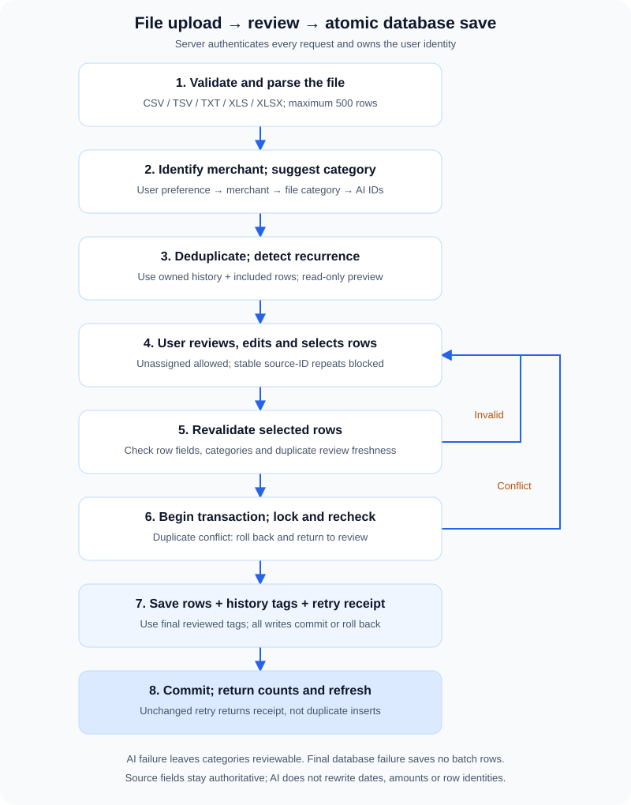
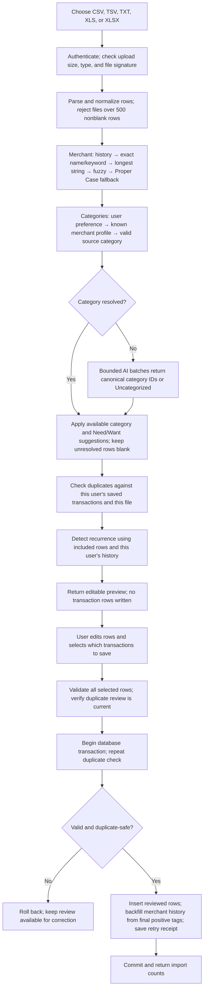
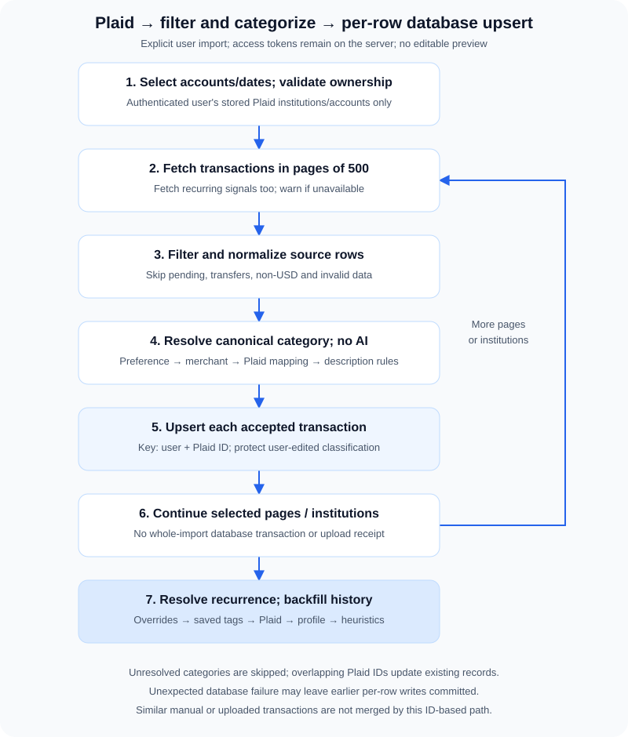
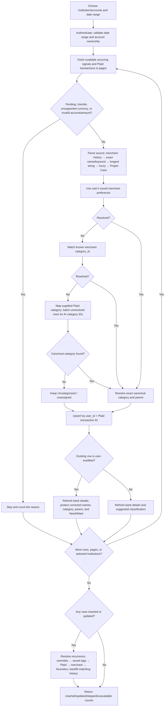
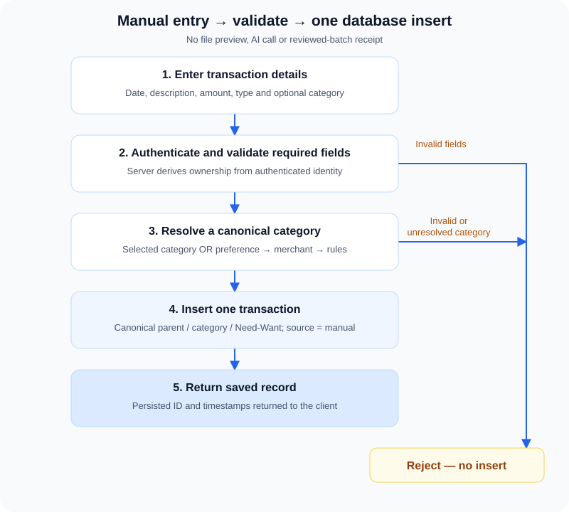
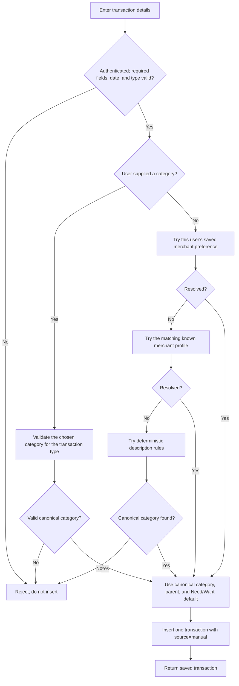

# Financial Transaction Ingestion and Processing

*Implementation guide, reviewed against repository code on October 25, 2026.* [Documentation index](README.md).

This guide covers the three ways transactions enter the Finance Tracker: user-uploaded files, transactions imported on request from Plaid-connected accounts, and transactions entered manually. It follows each path from the user's selection through validation, categorization, review or confirmation, and database persistence.

## At a glance

```text
File upload
Choose file → validate and parse → clean/identify merchants → categorize suggestions
→ check duplicates → detect recurrence → user reviews/edits → revalidate and recheck duplicates
→ atomically save selected rows + backfill merchant history + retry receipt → complete

Plaid
Choose accounts and dates → verify ownership → fetch available recurring signals and transaction pages
→ filter/parse → clean/identify merchants → preference/profile/source/AI category
→ upsert by Plaid transaction ID → protect user-edited names and categories
→ reuse saved tags or detect recurrence → backfill matching merchant history → import summary

Manual entry
Enter transaction → validate → use selected category or preference/profile/rules
→ insert one transaction → return saved row
```

The key difference is that **file uploads are previewed and edited before saving**, **Plaid rows are written immediately after the user clicks Import**, and **manual entries are written one at a time**. Files use source IDs when available and conservative content matching otherwise; Plaid retains its ID-based upsert behavior.

## Step-by-step ingestion flowcharts

The diagrams show the runtime path from the user's action to database writes. In particular, file preview and duplicate checks are read-only: transaction rows are inserted only after review and final validation.

The visible flowcharts are repository-local SVG images, so they do not require a Mermaid plugin, JavaScript, or an external diagram service. Each has a numbered text equivalent for viewers that cannot display images. Expand **Editable Mermaid source** only when maintaining a diagram; keep its SVG and text steps in sync.

### Uploaded file: preview, review, and atomic save



1. Authenticate, validate file type/signature/size, parse and normalize at most 500 nonblank rows.
2. Clean and identify merchant names using exact user history → exact catalog name/keyword → longest contained name/keyword → high-confidence fuzzy catalog matching → Proper Case cleaned fallback. Suggest categories using user preference → merchant profile → valid file category → batched AI IDs for unresolved rows.
3. Check duplicates within this file and the user's ledger, then detect recurrence using included rows plus the user's saved history. Return suggestions in a read-only editable preview; excluded duplicates do not supply extra observations.
4. User corrects fields, chooses Save rows, and explicitly confirms legitimate content matches. Stable-ID repeats cannot be saved.
5. Validate selected rows and review freshness; invalid input returns to review without a write.
6. Begin a database transaction, acquire the user lock, and repeat duplicate checks. A conflict rolls back the batch.
7. Insert selected `transactions`, propagate confirmed positive recurrence tags to matching unmodified historical rows, and write the `transaction_import_receipts` retry receipt together, then commit. This uses the review's final tags, not a second detection pass. Any insert or backfill failure rolls everything back.
8. Return counts and refresh the ledger. An unchanged retry returns the receipt instead of inserting again.

<details>
<summary>Editable Mermaid source — uploaded files</summary>



</details>

AI-unavailable or unresolved categories remain editable; a valid reviewed transaction may be saved as `unassigned`. If a duplicate conflict appears during final save, nothing from that reviewed batch is committed.

### Plaid: connected-account import and refresh



1. User chooses connected institution/accounts and dates; server authenticates and validates ownership/range.
2. Fetch active recurring-stream signals and Plaid transaction pages. Optional recurring-signal failures produce warnings; unavailable transaction institutions are reported while others continue.
3. Skip pending transactions, transfers, non-USD values and invalid rows.
4. Clean/identify accepted merchant names with the shared history → exact name/keyword → longest string → fuzzy → Proper Case fallback pipeline; categorize using user preference → merchant profile → compatible Plaid category mapping → batched AI category IDs. Keep unresolved rows as Uncategorized, stored as `unassigned`.
5. Upsert `transactions` by `(user_id, plaid_transaction_id)`; retain explicitly edited merchant/description and category/parent/Need-Want.
6. Continue all selected pages/institutions. Writes are per row, not one atomic whole-import transaction; an unexpected database error may leave earlier rows committed.
7. Resolve recurrence for merchants represented by the imported row IDs using the user's saved history. Reuse saved positive tags unless an explicit user override supersedes them; otherwise use provider/catalog/heuristic detection. Apply the resolved tags to imported and matching unmodified historical transactions, then return counts and refresh the ledger. Active owned-account Plaid outflow streams supply recurring flags/frequency when available; report a warning if the optional recurring endpoint is unavailable.

<details>
<summary>Editable Mermaid source — Plaid</summary>



</details>

An import can report an institution as unavailable while continuing with the remaining selected institutions. Plaid data is written during the import; there is no editable per-transaction preview.

### Manual transaction: single-row creation



1. User enters transaction details and optionally chooses a category.
2. Authenticate and validate required fields, date and transaction type.
3. Validate a supplied canonical category. Otherwise try user preference → merchant profile → description rules; no AI call.
4. Reject invalid input or an unresolved category without inserting.
5. Insert one `transactions` row with server-owned user ID and `source='manual'`; return the saved row.

<details>
<summary>Editable Mermaid source — manual entry</summary>



</details>

## Common transaction record

All three flows write to the `transactions` table. The signed-in user's ID is assigned by the server, not taken from an uploaded row or browser-supplied transaction identity.

| Field | What is stored |
|---|---|
| `date`, `description`, `merchant` | Transaction date and display/search text. Merchant falls back to description when needed. |
| `merchant_source`, `category_source` | Nullable text explaining how the saved merchant identity and category were determined. New imports and edits populate these fields; older transactions remain `NULL` because their original decision path cannot be reconstructed reliably. |
| `amount`, `type` | A positive numeric amount and a separate `income` or `expense` type. |
| `parent_category`, `subcategory` | Canonical category values; the parent may be empty for unassigned transactions. |
| `needs_want` | `need`, `want`, or `na`. |
| `is_recurring`, `recurring_type`, `recurring_freq` | Recurrence flag, canonical lowercase type (`subscription` or `recurring_bill`), and nullable frequency: `Weekly`, `Bi-Weekly`, `Semi-monthly`, `Monthly`, `Quarterly`, `Semi-Annually`, or `Annually`. Overrides/provider tags can supply frequency directly; heuristic inference requires at least three transactions. Default frequency is `NULL`. |
| `source` | `upload` for reviewed file imports, `plaid` for connected-account imports, or `manual` for single-row manual entry. |
| Plaid metadata | Plaid transaction ID, account ID/name, and institution name; populated only for Plaid rows. |
| Upload identity | Source transaction ID and account context, when supplied by the file; `upload_identity` is a hash of that account context plus source ID. |
| `notes`, timestamps | Optional notes and database-managed creation/update timestamps. |

The database constrains transaction type, Need/Want value, recurring type and frequency, and source. Amount is stored as `NUMERIC(12,2)`. Partial unique indexes protect `(user_id, plaid_transaction_id)` and `(user_id, upload_identity)` when those identities are present. Content-based similarities are deliberately not database uniqueness constraints: identical-looking charges can be legitimate.

## Merchant and category reference tables

`merchants` is a shared canonical profile catalog used during category suggestions and recurring classification. It does not contain a `user_id`; user-specific category preferences are instead derived from that user's manual transactions and explicit category-edit history.

| Column | Purpose |
|---|---|
| `id` | Merchant profile primary key. |
| `name` | Canonical brand name used for transaction matching; a unique index prevents duplicate exact names. |
| `logo_url` | Optional brand icon URL for display. |
| `category_id` | Optional foreign key to `transaction_type_list.id`; a known profile suggests this exact category row, including its canonical parent and Need/Want default. Deleting the category sets this field to `NULL`. |
| `is_known_subscription` | Defaults to `false`; explicitly identifies a subscription-only merchant. Can tag one transaction without waiting for three observations. |
| `is_known_recurring` | Defaults to `false`; explicitly identifies a recurring-bill-only merchant. Used when the subscription-only flag is not set. |

`transaction_type_list` remains the authoritative category dictionary, including transaction type, parent, display label, and Need/Want defaults. Merchant matching must resolve the profile's `category_id` against this table and confirm its transaction type. A missing category reference or income/expense mismatch does not supply a category.

Other persistence supporting these paths includes `transaction_import_receipts` (user-scoped, idempotent reviewed-file saves) and `transaction_change_history` (audit records used to preserve and reuse explicit user category choices). These support tables do not replace the transaction or canonical category records.

## How transaction categorization works

Categorization produces a suggestion from the app's canonical categories, not a free-form label. The allowed values come from `transaction_type_list`, including each category's transaction type, parent category, display label, Need/Want default, and description. Before a category is saved, the server resolves it against that list and stores the database's canonical parent/category labels. A user can still correct the suggestion in the file review.

Uploaded files and Plaid now share identification; manual entry retains its explicit-choice behavior:

| Source | Categorization method | AI used? |
|---|---|---|
| Uploaded file | Identify merchant; saved user category preference → known merchant profile → matching file category → AI category ID → Uncategorized for review | Only for unresolved rows |
| Plaid | Identify merchant; saved user category preference → known merchant profile → compatible supplied Plaid category/mapping → AI category ID → retain as unassigned | Only for unresolved rows |
| Manually entered transaction | User-selected canonical category → saved user merchant preference → known merchant profile → description rules | No |

### Shared merchant identification

After file validation and essential row parsing (or Plaid eligibility checks), and **before duplicate handling or subscription detection**, normalize merchant information to lowercase. Strip stacked SQ/TST/PAYPAL/STRIPE/VENMO/CASHAPP prefixes, hash/store/reference numbers, identifiable dates and phone numbers, trailing US state abbreviations (and optional ZIP), punctuation, and extra whitespace. Keep meaningful brand numbers, such as 7-Eleven, Forever 21, and Microsoft 365. Original descriptions, amounts, dates and reliable source identifiers are not rewritten.

1. Match the cleaned input exactly to this user's normalized historical merchant/description aliases. Preserve the historical merchant name. Explicit name corrections win over manual names and then automatic history; the latest applicable correction/update and transaction ID resolve ties.
2. Otherwise match a normalized global merchant name or individual comma-separated keyword exactly. Trim aliases, ignore empty aliases, and handle NULL keywords. Return the canonical catalog name, not the alias.
3. Otherwise find catalog names or individual keywords contained **anywhere** in the cleaned descriptor and select the **longest matched name/alias**. This is literal containment, not the previous guarded prefix rule: even incidental brand references can match. For exact-key collisions or equal-length containment ties, prefer a canonical-name match over an alias, then lowest merchant ID, then lexical name. This makes results stable regardless of database row order.
4. Otherwise accept only a clear, high-confidence fuzzy name/keyword match. Edit similarity must be at least **0.90**, both strings at least eight characters, and the winner must lead the next **distinct merchant** by **0.08**. Multiple similar aliases of one merchant do not count as competing merchants. Fuzzy work is bounded to 160-character strings.
5. If unmatched, use the cleaned merchant text in **Proper Case** (for example, `new local shop` becomes `New Local Shop`). No AI is used for merchant identity.

For example, catalog merchant `Walmart` with keywords `wal-mart,wm supercenter` resolves either alias to `Walmart`. When `wm supercenter fuel` is a keyword of a different merchant, it beats the shorter `wm supercenter` keyword in a descriptor containing both.

The category dictionary is loaded once, and merchant catalog (including keywords) and this user's history each use one query per ingestion context, independent of transaction count. Exact/category lookups use reusable maps, literal matching uses a reusable character trie, fuzzy candidates are length-indexed, and repeated cleaned descriptors reuse cached identity results. No per-row matching SQL is issued. Rows are resolved and unresolved AI work collected together; final result assembly does not repeat matching. AI requests remain bounded to 25 rows, 27,000 prompt characters and three concurrent batches.

History queries and aliases are scoped to the signed-in user. Merchant edits recorded during file review or transaction editing provide aliases for future imports; final reviewed category corrections are audited as explicit category preferences. Automated saved categories or recurrence/Need-Want edits alone are not explicit category preferences.

### Shared category identification, step by step

1. **Establish the row's source type and resolve its merchant.** File type comes from explicit labels or debit/credit columns, defaulting to expense when unavailable. Plaid's amount sign determines direction: negative means income; otherwise expense. Merchant identification uses the shared pipeline above.
2. **Use this user's explicit category preference.** Match the resolved merchant or source alias and transaction direction against manual transactions or recorded category/parent edits. Recorded edits take precedence over manual entries; latest applicable edit/update and ID break ties. Reuse only a still-valid, type-compatible canonical category.
3. **Use the global merchant profile.** Resolve its `category_id` to the exact canonical row, parent and Need/Want default. Missing/stale or incompatible income/expense references supply no category. An expense-brand profile never changes an income/refund into an expense.
4. **Match supplied category information.** Match canonical labels ignoring case, punctuation and ampersand formatting; a supplied parent narrows the match. For files, nonblank Subcategory takes priority over Category regardless of header order; explicit Parent Category wins, otherwise a distinct Category accompanying Subcategory supplies the parent. Duplicate labels without a disambiguating parent stay unresolved. Plaid tries compatible category labels and its explicit category mappings. Unmatched file source labels remain visible in review.
5. **Ask AI only for unresolved rows, in bounded, concurrent batches.** Send lookup columns `id`, `type`, `parent_category`, `category`, `description`, a server-owned `sourceIndex`, resolved merchant, source type, date, amount and bounded source context. The prompt requests JSON `{entries:[{sourceIndex:number,categoryId:number|null}]}`; null means **Uncategorized**. Batches contain at most 25 rows and 27,000 prompt characters, within the shared provider's 28,000-character total and 1,800-token completion budgets. Up to three requests run concurrently, with only income/expense categories present in each batch. An oversized catalog/row stays unresolved rather than being silently truncated. The provider/model is unchanged.
6. **Validate every returned ID.** The index must belong to this batch and appear exactly once; all duplicate results for an index are rejected. The category ID must be an integer from the supplied lookup and compatible with the source transaction direction. Resolve its canonical stored parent/category labels and eligible Need/Want default server-side. AI cannot change source type, dates, amounts, descriptions, merchant identity, recurrence tags or row identity.
7. **Keep uncertainty reviewable.** Failed, malformed, missing, invalid or ambiguous responses leave rows Uncategorized. File review shows an explicit count and editable optional category; saved unresolved rows use the existing `unassigned` ledger sentinel. Plaid retains valid unresolved rows as `unassigned` and returns an `uncategorized` count with a review warning. Failed batches do not prevent later batches. No new category is inserted into the lookup table.

New file/Plaid automated identification persists these case-sensitive source values:

| Merchant path | `merchant_source` |
|---|---|
| User history | `USER_HISTORY` |
| Exact catalog name/keyword | `EXACT_MATCH` |
| Longest contained catalog name/keyword | `MERCHANT_STRING_MATCH` |
| High-confidence fuzzy catalog match | `FUZZY_MATCH` |
| Proper Case cleaned fallback | `NO_MATCH` |

| Category path | `category_source` |
|---|---|
| Explicit user category preference | `USER_HISTORY` |
| Type-compatible catalog category | `MERCHANT_CAT` |
| Matched source file/Plaid category | `BANK_DATA_CAT` |
| Validated AI category ID | `AI_MATCH` |
| Unresolved/failed classification | `NO_MATCH` |

Manual/edit provenance (`manual_entry`, `user_selected`, `user_edit`, and existing manual fallback labels) remains unchanged. Legacy lowercase labels remain accepted for previews already open in a browser; existing rows are not relabeled or reclassified. Missing source metadata from an older client remains `unknown`. These fields describe the winning decision path, not confidence scores. An unresolved replay preserves an existing valid saved category and its provenance rather than erasing it.

Only unresolved rows are sent to AI. Source context includes at most the first 24 source fields, bounded to 400 characters each (nested values serialized); the primary merchant/description context is bounded to 2,000 characters each. These limits affect AI context only, never the original financial values or stored source description. No application user ID, user's historical ledger, or Plaid access token is supplied by the server. Treat files as financial data and avoid unrelated sensitive columns.

The preview's hidden original-merchant alias is also bounded to 2,000 characters before review. It is audit metadata, not a source financial value; correcting an overlong visible merchant must not leave uneditable metadata that blocks saving.

When an uploaded row contains a valid Need/Want value, that value is preserved. Otherwise, the selected canonical category's Need/Want default is suggested when available; unresolved categories use `na` until the user changes it. The reviewer can edit both the category and Need/Want value before saving.

### Plaid categorization, step by step

Plaid uses the same merchant/category pipeline and AI fallback as files, after transfer, pending, currency, account, amount, date and ID checks. At the source-category step, compatible supplied labels and `personal_finance_category` mappings are tried:

| Plaid category condition | FinVision360 category suggestion |
|---|---|
| Income detail contains `WAGES`, `DIVIDEND`, `INTEREST_EARNED`, or `TAX_REFUND`/`REFUND` | Salary, dividend, interest, or refund respectively |
| Income primary is `INCOME` and no more specific income detail matched | Other Income |
| Expense primary is `RENT_AND_UTILITIES` | Housing for rent/mortgage details; otherwise utilities |
| Expense primary is `FOOD_AND_DRINK` | Groceries for grocery details; otherwise dining out |
| Expense primary is `ENTERTAINMENT`, `TRANSPORTATION`, `MEDICAL`, `PERSONAL_CARE`, `TRAVEL`, `GENERAL_MERCHANDISE`, `HOME_IMPROVEMENT`, `LOAN_PAYMENTS`, or `BANK_FEES` | Entertainment, transportation, healthcare, personal care, travel, shopping, housing, debt payment, or other expense respectively |
| Government/non-profit primary with a tax detail | Taxes |
| No listed mapping applies or mapped category is unavailable | Shared batched AI fallback, then retain as unassigned |

### Manual-entry description rules

Only manual entry retains the legacy description-rule fallback below. It is not a hidden extra step ahead of AI for file or Plaid imports. The first matching rule wins.

| Income rule, in order | Example terms in the description | Suggestion |
|---|---|---|
| 1 | Salary, payroll, direct deposit, wages, pay stub | Salary |
| 2 | Bonus | Bonus |
| 3 | Freelance, consulting, contract work, Upwork, Fiverr | Freelance |
| 4 | Dividend, distribution | Dividend |
| 5 | Interest, APY, savings yield | Interest |
| 6 | Rental income, rent received, tenant | Rental |
| 7 | Capital gain, stock sale, security sold | Capital gains |
| 8 | Refund, cash back, rebate | Refund |
| 9 | Business income, revenue, invoice | Business |
| 10 | Gift, Zelle, Venmo, Cash App, PayPal | Gift |
| No match | — | Unassigned |

| Expense rule, in order | Example terms in the description | Suggestion |
|---|---|---|
| 1 | Mortgage, rent (unless “rent received”), HOA fee, property tax, homeowners, house | Housing |
| 2 | Electric, gas/water bill, internet/broadband, listed telecom or energy providers | Utilities |
| 3 | Grocery terms, supermarket, listed grocery stores | Groceries |
| 4 | Uber (exact match), Lyft, gas stations, parking, transit, auto loan/car payment | Transportation |
| 5 | Restaurants, delivery services, cafes and restaurant/food terms | Dining out |
| 6 | Streaming/music services, cinemas, concerts, ticket services, entertainment terms | Entertainment |
| 7 | Pharmacies, hospitals, clinics, doctors, dental, vision, healthcare/medical terms | Healthcare |
| 8 | Insurance or listed insurance providers | Insurance |
| 9 | Tuition, universities, colleges, course services, student loan, Khan Academy | Education |
| 10 | Retailers and marketplaces such as Amazon (not Amazon Web Services), Target, IKEA, or Home Depot | Shopping |
| 11 | Music/cloud/software services, gym memberships, Prime membership, subscription | Subscriptions |
| 12 | Salon, barber, spa, beauty supply, nail or hair-cut terms | Personal care |
| 13 | Airlines, hotels, travel-booking services, Airbnb, VRBO | Travel |
| 14 | Credit-card, card, loan or student-loan payment | Debt payment |
| 15 | Vanguard, Fidelity, Schwab, ETF/mutual-fund/stock purchase, Robinhood, Coinbase, AWS | Investment |
| 16 | IRS, income/state/property tax, tax payment/withholding | Taxes |
| 17 | Transfer to savings, savings deposit/transfer, high-yield savings | Savings transfer |
| No match | — | Unassigned |

These manual-entry rules are deterministic, not a confidence-ranked model. Their order matters: for example, the housing rule appears before taxes and includes “property tax,” so a description matching that rule is categorized as housing. A manual entry without a resolvable category is rejected; this does not apply to the file/Plaid unresolved fallback.

The internal rule labels are mapped to the current canonical category table before insertion. A category's canonical parent and Need/Want default are saved with it; if the category has no Need/Want default, the import uses `na`. On a later Plaid upsert, categorization is refreshed unless the transaction has been marked user-modified; in that case its existing category, parent category, and Need/Want values are preserved.

### Manual choices and future file imports

Manual transaction entry accepts a user-selected canonical category. If the user omits it, the server tries this user's saved merchant preference, then a type-compatible known merchant profile, then description-based deterministic rules, and rejects the entry if it still cannot resolve a canonical category. A manual category choice, or an explicit category/parent edit recorded in transaction history, can become the saved merchant preference used by later file imports, manual entries, and Plaid imports. This preference is scoped to the signed-in user and transaction type. Reviewed file saves retain the reviewer's final category selection rather than rerunning merchant categorization. Existing user-modified Plaid rows keep their category, parent, and Need/Want values on refresh.

# File uploads

## 1. User selects a file

The Finance Tracker file-import panel accepts `.csv`, `.tsv`, `.txt`, `.xls`, and `.xlsx` files, one file at a time, up to 5 MiB. The browser checks the extension and size before enabling **Preview File**. The server repeats the size check and verifies the extension against the MIME type; XLS/XLSX files also need the expected file signature.

Uploads are handled in memory. The current flow does not save the original file as a permanent document.

## 2. Server parses and bounds the file

The authenticated preview request is `POST /api/transactions/ingest/preview`, with the file in multipart form data. The server:

1. Rejects unsupported or mismatched file types and unreadable/corrupt content.
2. Parses CSV/TSV/TXT as UTF-8 text, or reads the workbook for XLS/XLSX. A delimited file uses its first nonblank record as the header; columns may be in any order. Header matching ignores case, spaces, and punctuation.
3. Recognizes date headers such as `Date`, `Transaction Date`, and `Posted Date`; description headers such as `Description`, `Merchant`, `Name`, `Memo`, and `Text`; and amount headers such as `Amount`, `Value`, `Debit`, and `Credit`.
4. Excludes completely blank rows and counts them for the review screen. A nonblank row is retained even if required values are missing or invalid, so the user can correct it.
5. Rejects an import with more than 500 nonblank rows instead of silently previewing only part of the file. It also rejects empty or corrupt files.

For delimited files, records are limited to 20,000 characters. XLSX archives are bounded during parsing. Invalid dates, descriptions, amounts, or categories are not silently considered valid just because a parser produced a row.

## 3. Server maps source fields into review rows

Each nonblank source row becomes an editable transaction draft. The importer normalizes fields for the preview:

- **Date:** ISO and US-style dates are normalized when valid. Dates that cannot be normalized remain visible for correction and fail save validation until fixed.
- **Description and merchant:** The source description is retained; merchant is identified from source merchant/description using the shared cleanup/history/catalog/fuzzy pipeline.
- **Amount and type:** Currency symbols and grouping commas are accepted for parsing. Parentheses and minus signs are recognized as negative source notation, but the stored amount is a positive magnitude; income versus expense is a separate field. Type comes from an explicit type column or debit/credit layout when available, and otherwise defaults to expense. Type labels such as credit/deposit and debit/withdrawal are recognized.
- **Need/Want and recurrence:** Recognized values are normalized. Missing Need/Want becomes `na`; recurrence can be reviewed as false/true and, when true, assigned a supported recurrence type.
- **Source category:** An uploaded category is retained separately in the preview so the reviewer can compare it with the selected canonical category. The raw source category is not a transaction-table column.
- **Source identity:** `Transaction ID`, `Bank Transaction ID`, or `FITID` is recognized as a transaction identifier. A generic `ID`, row number, or `Reference` is not treated as reliable. Account context comes from `Account ID`, `Account Number`, `Account Name`, or `Account`; absent context uses the user's unqualified source-ID namespace. Temporary review row numbers are never financial duplicate keys.

The preview drafts receive temporary row numbers for editing. These numbers are not database transaction IDs.

## 4. Category suggestions are prepared

The categorization priority, AI ID validation, canonical Need/Want defaults, and Uncategorized fallback are described in [How transaction categorization works](#how-transaction-categorization-works). After merchant identification, each row tries the user's saved category preference, then a known merchant profile, then a valid file category, then batched AI. Suggestions remain editable and preview writes nothing.

## 5. Duplicate identification, after categorization

The server compares normalized, categorized drafts with earlier included rows in the file and existing transactions owned by the signed-in user. Other users' records are never candidates.

| Finding | Rule | Default and user action |
|---|---|---|
| Stable source ID | Same source transaction ID and normalized account context, even if date/amount/text changed | Excluded; cannot be kept or saved a second time |
| Exact-looking content | Same date, amount to the cent, type, and full normalized description | Unchecked/excluded by default; select its **Save** checkbox only if it is a separate real transaction |
| Possible content match | Same amount/type and matching normalized merchant or description, on the same date or within two days | Unchecked/excluded by default; inspect the match details and select its **Save** checkbox only for a legitimate repeat |

Description comparison normalizes case/punctuation; merchant comparison uses the same cleanup key for new drafts and historical candidates. Duplicate comparison itself is exact on these keys, never fuzzy, and content matches always remain reviewable. When both files provide different account contexts, they are not matched to one another. Missing account context does not prove that records belong to different accounts. Reliable source IDs and account namespaces are unchanged by merchant cleanup.
Different reliable IDs in the same account namespace identify separate transactions even when the dates, amounts and descriptions are identical.

Warnings explain the matching rule and identify a stored transaction or earlier review row. Checks never delete, merge, or alter existing transactions.

## 6. User reviews the preview

The browser receives the draft rows and displays an editable table. Nothing has been written to `transactions` yet. The user can:

- Edit date, description, merchant, amount, type, category, Need/Want, recurring status/type, and notes.
- See the original source category separately when it differs from the current category choice.
- Remove unwanted rows or add a new row.
- Discard the review and choose another file.
- Include/exclude rows with the **Save** checkbox. A checked possible-match row is the explicit confirmation to save a legitimate repeat; reliable-ID repeats remain locked out.

Completely blank rows are reported as excluded. Invalid nonblank rows remain in the table and show field-level errors. Only selected rows must pass validation to save; an excluded invalid row does not block the batch. Category is optional: the user can choose a canonical category or leave the transaction unassigned.

Editing a matching field resets its duplicate override and triggers a version-guarded recheck through `POST /api/transactions/import-reviewed/check`. This endpoint writes nothing. A failed recheck preserves the editable review and blocks saving until the check is retried.

## 7. Server validates the reviewed batch

When the user clicks **Save**, the browser posts all review rows and a UUID `requestId` to `POST /api/transactions/import-reviewed`. The server checks row shape/IDs and validates every selected row before opening a database connection:

- Batch must contain 1–500 entries.
- Date must be a real calendar date.
- Description is required.
- Amount must be positive, nonzero, have no more than two decimal places, and not exceed `$9,999,999,999.99`.
- Type must be `income` or `expense`.
- Any selected category must match a canonical category for the chosen type and parent; a parent cannot be supplied without a category.
- Need/Want must be `need`, `want`, or `na`.
- Recurring status must be boolean. A recurring row must have type `subscription` or `recurring_bill`; a non-recurring row must not have a recurring type.

If any selected row fails, the server returns field-specific validation errors (`422`). No rows are written; the review remains available. Source identities must be text of at most 256 characters. Each review row must have a unique integer ID. A category-list loading error also disables saving.

## 8. File rows are committed atomically

After selected rows validate, the server begins a PostgreSQL transaction and obtains a user-scoped advisory lock. It rechecks selected rows against the current ledger and one another. Stable-ID duplicates always fail; new content matches require explicit keep confirmation. A conflict returns `409 / DUPLICATES_CHANGED`, rolls back, and refreshes duplicate warnings without discarding edits.

Selected rows are inserted with `source='upload'`. Canonical category values are stored; a category-less row uses `subcategory='unassigned'` and no parent category. The database generates permanent row IDs and timestamps.

- If every insert succeeds, the server commits the batch.
- If any insert fails, it rolls back the entire batch; the user does not get a partially saved reviewed import.
- The original upload is not retained. Only the reviewed transaction fields are saved.
- Detection runs after normalization, categorization and duplicate checking, immediately before preview. It reads history without writing transactions. Save does not rerun it: final review values remain authoritative.
- Editing recurrence status, type or frequency in review marks an explicit override. Saving audits these choices and protects the saved row, including an explicit choice of not recurring.

After inserting the reviewed rows, backfill matching unmodified history from the final positive recurrence tags, in the same database transaction as the rows and retry receipt. Never modify any newly reviewed row during this backfill, including a row left not recurring. Explicit historical overrides remain authoritative. If final positive rows for the same merchant conflict, choose the newest transaction date and then highest database ID for historical backfill; keep every reviewed row's own choice.

Successful saves write selected rows plus a durable receipt in `transaction_import_receipts` in the same transaction. The receipt records the signed-in user, request UUID, canonical payload hash, and result. Retrying an unchanged request returns the previous result instead of inserting again—even if the first response was lost after commit, or retries arrive concurrently. Reusing a committed UUID with changed data fails with `REQUEST_ID_REUSED`. Changed review payloads get new UUIDs; failed transactions leave no receipt.

Results report inserted, uncategorized, recurring-selected and excluded/skipped counts. Removed rows and completely blank rows are handled separately in review. The Finance Tracker displays the result and refreshes the transaction list.

## Event-driven progress and failures

The interface shows **Validate file → Process & categorize → Check duplicates → Review rows → Save & complete**. The final visible step is active while the save is being committed and becomes completed only after the server confirms the transaction and receipt are committed. Reviewing alone does not write transaction rows. Preview requests add `?progress=1` and receive newline-delimited JSON stage events, a preview, or an error. Categorization is a normal JSON model call; progress events are not model-token streaming. Non-streaming clients can still request the JSON preview.

Completed, active, upcoming and failed stages reflect actual work; there are no invented percentage timers. Finalization starts when submitting the save; completion follows a committed result/receipt. Parse, duplicate-check and save errors preserve the file or editable review as appropriate. Retry an uncertain save unchanged before assuming nothing was written.

### Retired immediate-save APIs

`POST /api/transactions/ingest` and legacy CSV/JSON `POST /api/transactions/bulk` now return `409 / REVIEW_REQUIRED` without writing. The single-transaction endpoint rejects `source='upload'`. File-import clients must use preview and reviewed save; manual and Plaid imports retain their existing behavior.

# Plaid-connected transactions

## 1. User chooses institution, account, and date range

The connected-account import panel lets the user choose all institutions or one institution, all eligible accounts or one account, and a start/end date. The browser submits only those selections to `POST /api/transactions/import-from-plaid`; Plaid access tokens remain server-side. There is no per-transaction editable preview in this flow.

The server requires valid dates, prevents a future end date, limits the range to two years, and verifies that the selected institution/account belongs to the signed-in user. At least one connected institution is required.

## 2. Server retrieves transactions from Plaid

For each selected Plaid Item, the server calls Plaid's date-range transaction endpoint using the stored Item access token. Results are fetched in pages of 500 until the reported total is reached. If an account was selected, the Plaid request is restricted to that account.

If Plaid cannot return transactions for one institution, that institution is listed as unavailable and the server continues with other selected institutions. This is reported as a partial result, not as a transaction preview.

## 3. Plaid rows pass import checks and are normalized

Each returned row is checked before persistence:

- Pending transactions are skipped.
- Transfers are skipped when Plaid's primary category is `TRANSFER_IN` or `TRANSFER_OUT`, or the detailed category is `LOAN_PAYMENTS_CREDIT_CARD_PAYMENT`.
- Only `USD` is imported; there is no currency conversion.
- The account must belong to the current stored institution and selected user-owned accounts, amount must be finite/nonzero, date must be valid, and Plaid transaction ID must be nonblank. A missing category is not an eligibility failure.

For accepted rows:

- Plaid's amount sign determines type: a negative amount is treated as income, otherwise expense. The stored amount is the absolute value.
- Description preserves `original_description`, then `name`, then `merchant_name`, then `"Bank transaction"` as fallback. Merchant identification starts from `merchant_name` or the available source narrative.
- The shared pipeline identifies the merchant and tries user category preferences, compatible global profiles, supplied Plaid category information and batched AI IDs, retaining unresolved rows as `unassigned`. See [How transaction categorization works](#how-transaction-categorization-works).
- Parent category and Need/Want come from the matched canonical category, defaulting Need/Want to `na` if it has none.
- The saved row includes `source='plaid'`, Plaid transaction/account IDs, account name, and institution name.

Rows that fail a check are counted under pending, transfer, unsupported currency, or invalid/unavailable reasons and are not inserted.

## 4. Plaid transactions are inserted or updated immediately

The database has a unique key for each non-null Plaid transaction ID within a user. The server uses `INSERT ... ON CONFLICT` with that key:

- A new Plaid ID creates a transaction.
- An existing Plaid ID updates the existing transaction instead of creating a duplicate. Re-importing overlapping date ranges therefore does not duplicate a matching Plaid transaction.
- Date, amount, type, source and Plaid account metadata are refreshed. Description/merchant refresh unless a name correction was explicitly audited.
- If the existing transaction is marked `is_user_modified`, category, parent and Need/Want are preserved; otherwise classification fields are refreshed through the shared pipeline.
- An unresolved incoming classification is not a request to erase a valid earlier classification. On an overlapping Plaid ID with the same income/expense direction, retain its existing category, parent and Need/Want when the new result is unassigned (including AI failure). New unresolved IDs still save as unassigned. Import warnings/counts reflect the persisted result.

The Plaid route issues database upserts row by row and does not wrap the entire multi-institution import in one database transaction. Institution retrieval errors are reported as unavailable and processing continues. An unexpected database error can fail the request after earlier rows have already committed.

The importer upserts rows returned by Plaid; it does not delete existing transactions that are absent from the selected response. It also does not merge a Plaid row with a similar manual or uploaded row because those rows do not share the Plaid transaction ID.

## 5. Recurring detection and import summary

### When it runs

- **File uploads:** after parsing, standardization, categorization and duplicate checking, immediately before preview. Included incoming rows combine with the same user's historical transactions. Excluded duplicates do not count again. Detection is read-only; the reviewer can change suggested tags. Save persists final review values without rerunning detection.
- **Plaid:** on every import, fetch available recurring signals, save accepted transactions, then resolve recurrence for the imported merchants and update their matching historical transactions as well. Existing corrected rows remain protected; unrelated merchants and other users are not updated. There is no per-row Plaid preview.
- The authenticated `POST /api/transactions/detect-recurring` endpoint uses the same engine for an explicit ledger-wide recheck; the Transactions page does not expose a manual detection button.

### Merchant identity and priority

Exact normalized merchant identity takes precedence. Missing merchants or copied bank descriptors allow guarded whole-token canonical matching, preferring longer names and rejecting ambiguity. Incidental brands never replace distinct explicit identities. Matched charges group by merchant ID; unmatched explicit identities group by normalized merchant name, while copied descriptors retain the first-three-word fallback.

1. **User history always wins.** Recurrence-specific audit edits, explicit file-review recurrence edits, and manually entered positive tags supply the merchant's tags. If choices conflict, the latest explicit choice wins for new/unmodified rows; transaction ID breaks ties. Existing corrected rows are never rewritten. Negative overrides propagate `is_recurring=false` and clear type/frequency. Category-only corrections do not establish recurrence preferences.
2. **Reuse existing positive tags.** If any saved transaction for this user's merchant has `is_recurring=true`, reuse its `is_recurring`, `recurring_type` and `recurring_freq` exactly, including a `NULL` frequency, rather than running provider/catalog/heuristic classification again. This includes automatically tagged history, not only user edits. If saved positive rows conflict, use the newest transaction date and then highest database ID. Draft preview rows do not count as saved history. Explicit user overrides, including negative choices, still win.
3. **Plaid flags.** Use explicit subscription/recurring flags when present. Standard transaction responses currently omit them; `/transactions/recurring/get` supplies active outflow stream membership and frequency. Map only owned accounts and imported IDs. A stream signals `recurring_bill` unless it explicitly supplies a subscription flag; never invent that flag from a merchant name. If the optional endpoint is unavailable, warn and continue with the remaining priorities. Supplied file recurrence tags remain reviewable unless user history or existing saved positive tags supersede them. The newest dated provider-tagged transaction (then highest ID) supplies one consistent set of tags for the merchant group.
4. **Merchant-only profiles.** `is_known_subscription=true` sets `subscription`; otherwise `is_known_recurring=true` sets `recurring_bill`. These explicit profiles require no minimum history. Infer frequency if sufficient history exists, otherwise leave it `NULL`. Detection does not seed profiles.
5. **Core heuristic engine.** When higher priorities do not supply tags, require at least **three valid expense transactions from the merchant**, including the user's saved history.

### Step A — temporal analysis

Sort the merchant cluster by date and calculate consecutive `days_difference`. All windows are inclusive:

| Frequency | Nominal days | Accepted interval |
|---|---:|---:|
| Weekly | 7 | 6–8 |
| Bi-Weekly | 14 | 13–15 |
| Semi-monthly | 15 | 14–16 |
| Monthly | 30 | 27–33 |
| Quarterly | 90 | 85–95 |
| Semi-Annually | 180 | 175–195 |
| Annually | 365 | 360–370 |

- **3–4 transactions:** the median interval must fall in a cycle window.
- **5+ transactions:** at least **80% of all intervals** must fall in the cycle window. Four qualifying intervals out of five passes; three out of four does not.
- Alternating **14/16-day gaps are Semi-monthly**, not Bi-Weekly. For other overlapping windows, choose the qualifying cycle closest to the median; steady 14-day gaps are Bi-Weekly.
- Qualifying clusters set `is_recurring=true` and `recurring_freq` to the selected label. Insufficient/nonqualifying history alone produces no heuristic tag.

### Step B — amount variance

Calculate the median amount of the entire qualifying merchant cluster. If **every amount** is within inclusive **±5%** of that median, set `recurring_type='subscription'`; otherwise set `recurring_type='recurring_bill'`. These lowercase strings are the database/API values even when the UI displays “Subscription.”

Invalid dates, nonpositive/invalid amounts, income and transfers do not supply heuristic observations. Valid corrected rows may supply history, but are never automatically overwritten. Writes recheck ownership and recurrence audit protection to avoid racing user edits.

### Historical propagation

When a merchant is confirmed recurring, propagate the same `is_recurring`, `recurring_type` and `recurring_freq` to eligible historical expense transactions for that merchant and user. Imported Plaid IDs scope the affected **merchant groups**, not just the updated rows; unrelated merchants remain untouched. Existing user-modified rows and recurrence-specific audited rows are protected, even if their values differ. The ledger-wide recheck uses the same rules. A stored positive classification is intentionally reused rather than re-evaluated when later amounts or intervals differ; an explicit user correction can supersede it.

File previews remain read-only. File history backfill occurs only when the user saves, using final reviewed positive tags without running detection again or changing the reviewed rows. It commits or rolls back together with the entire reviewed import and retry receipt. The existing file `recurringMarked` count describes positive imported rows; Plaid's count includes historical rows whose tags changed.

The Plaid UI shows **New**, **Updated**, **Skipped**, and **Unavailable**, skip reasons, institution errors, optional recurring-signal warnings, and the count of changed recurrence tags. The ledger refreshes after import.

## Duplicate and retry summary

| Import path | Re-import behavior |
|---|---|
| Reviewed file upload | Checks file/ledger duplicates; source-ID duplicates blocked, content matches need explicit keep; unchanged retries return receipts. |
| Direct file-ingest / legacy bulk APIs | Refuse writes with `REVIEW_REQUIRED`; clients must use the reviewed workflow. |
| Plaid date-range import | Matches on `(user_id, plaid_transaction_id)` and updates the existing row; overlapping imports of the same Plaid ID do not create duplicates. |
| File uploaded after Plaid/manual entry | Compares against existing records across all sources using content rules; similar records require review. |
| Plaid imported after a file | Plaid remains ID-based and does not merge file rows. Import order can still matter; existing duplicates are not cleaned up. |

## Main code references

- `client/src/components/finance-tracker/transaction-file-import.tsx` — file selection, editable preview, and save request.
- `client/src/components/finance-tracker/transaction-file-import-validation.ts` — browser-side row validation.
- `client/src/components/finance-tracker/connected-accounts-import.tsx` — Plaid import choices and result display.
- `client/src/pages/finance-tracker.tsx` — import dialogs, success messages, and transaction-list refresh.
- `server/asset-liability-ingestion.ts` — CSV/TSV/TXT and spreadsheet parsing.
- `server/transaction-import.ts` — file-field normalization, server validation, and atomic reviewed-batch inserts.
- `server/merchant-matching.ts` — normalized exact/descriptor matching shared by category and recurring logic.
- `shared/transaction-duplicates.ts` — conservative matching rules and duplicate explanations.
- `server/transaction-duplicates.ts` — owner-scoped checks, locking, receipts, and retry-safe finalization.
- `server/finance-tracker-routes.ts` — preview, direct import, Plaid retrieval, category mapping, deduplication, and recurring detection.
- `server/ai/provider.ts` — shared model provider used for file-category classification.
- `shared/transaction-import.ts` — preview and result contracts.
- `server/recurring-transactions.ts` — priority rules, cycle windows and median amount variance.
- `server/recurrence-ingestion.ts` — read-only preview enrichment, owned history/override lookup and protected persistence.
- `server/plaid-recurrence.ts` — provider flag/frequency normalization and active owned-account stream mapping.
- `shared/schema.ts` — transaction, merchant, category, and import-receipt schemas and their key constraints.
- `server/transaction-import-schema.ts` — narrow, additive migration called by the existing application schema bootstrap before routes start. Both `npm run dev` and the published `dist/index.cjs` apply it; concurrent cold starts are serialized, failures stop startup, and no existing transaction data is changed.
- `scripts/transaction-import-schema.ts` — optional standalone runner for the same migration (`npx tsx scripts/transaction-import-schema.ts`); normal application/deployment startup does not depend on running it manually.

## Related documentation

- [AI Lab: How Questions Become Responses](AI_Lab.md) — AI request boundaries and response handling.
- [Budget Planning](Budget_Planning.md) — how transaction data feeds historical budget actuals.
- [Database schema](Database_schema_tables.md) — merchants, canonical categories, transaction identities and receipts.

Bank-rate maintenance is separate from transaction ingestion. Bank rates are manually entered or uploaded by administrators; there is no bank-rate web scraping or Firecrawl step in any of these flows.
